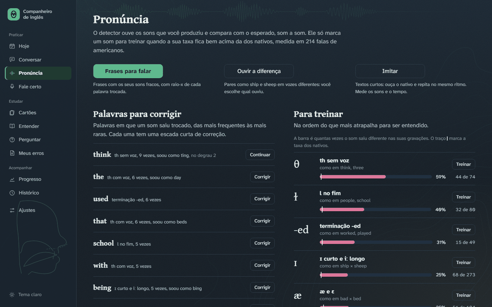
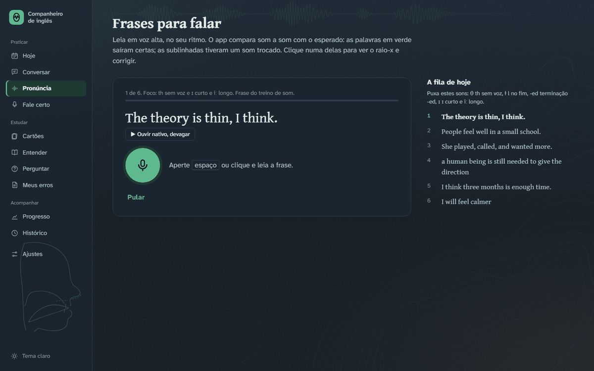
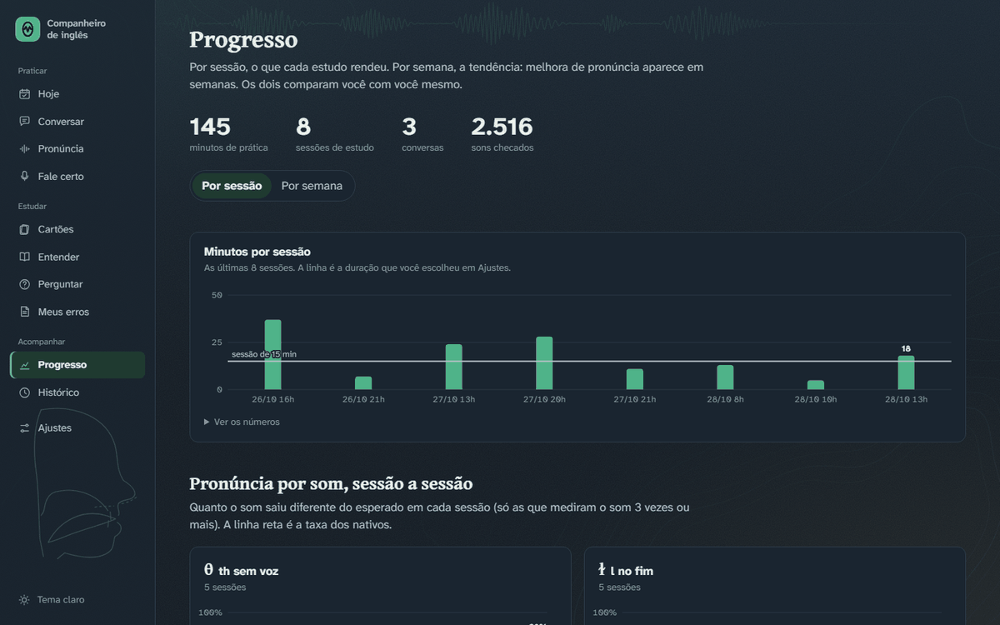

# Companheiro de inglês

Laboratório de fala para uma pessoa só. O app conversa com você, ouve a sua pronúncia som a
som, treina o ouvido, guarda os erros que se repetem, revisa tudo em cartões (como o Anki),
responde dúvidas com os seus dados e monta uma sessão por dia com o que mais precisa de treino.
Cada pessoa roda no próprio computador, com os próprios dados; para passar aos amigos, veja
"Para os amigos".

O visual segue o `IDENTIDADE.md` (o conceito, a marca, as cores, os tipos e os motivos): leia antes
de mexer em qualquer tela.

## Para quem chega de fora

Projeto pessoal, feito em três dias (26 a 28 de outubro de 2026) para um problema meu: leio
inglês técnico sem esforço e travo na hora de falar. Em vez de um curso, um instrumento de
medida. O app ouve o que eu falo, compara som a som com o que um nativo faria e monta o treino
do dia a partir do que saiu diferente. Está em uso diário e pronto para rodar no computador de
amigos, cada um com os próprios dados.



*Pronúncia: as palavras em que um som saiu trocado e, ao lado, cada som com a sua taxa contra a dos nativos.*



*Frases para falar: você lê, o app compara som a som e marca a palavra em que algo saiu diferente.*



*Progresso: por sessão, o que cada estudo rendeu; a linha reta é a taxa dos nativos.*

### O que tem dentro

- **Interface:** HTML e JavaScript puro, em módulos ES, com roteador por hash e uma tela por
  arquivo em `static/js/views/`. Sem framework e sem build. Tema claro e escuro, responsiva de
  375 a 2560 px.
- **Servidor:** FastAPI e SQLite, com migrações que rodam ao ligar e backup diário do banco.
- **Voz, em CPU:** o Whisper `small.en` dá o texto e o tempo de cada palavra; um modelo wav2vec2
  de fonemas dá os sons que saíram. O alinhamento com o CMUdict e um conjunto de regras diz o que
  mudou e onde. O detector foi validado com 214 falas de nativos (CMU ARCTIC e LibriSpeech): o
  ruído ficou em no máximo 2,5% por som, e um som só vira "treinar" quando o intervalo de
  confiança (Wilson, 95%) fica acima do teto dos nativos.
- **LLM:** o Claude entra em seis lugares: o tutor da conversa, a etiqueta de cada erro, o
  julgamento de uma correção dita de volta, as aulas de Entender, os cenários e textos "do seu
  mundo", e o Perguntar, que responde com os seus dados e executa ações (criar cartão, guardar
  palavra, mudar o som da vez) com desfazer. Três formas de ligar: o Claude Code da máquina, a
  API da Anthropic ou o intermediário abaixo.
- **Memória:** cartões com FSRS-4.5; gramática em caixas de Leitner; a sessão do dia ordena os
  sons pela distância até os nativos, com peso maior para o que mais atrapalha o entendimento.
- **Intermediário para amigos (`infra/`):** uma Lambda com URL própria, DynamoDB com uma chave
  por pessoa (guardada como hash) e teto mensal em dólar, chamada ao Bedrock assinada com SigV4,
  tudo em Terraform e dentro do nível gratuito da AWS.
- **Distribuição:** `empacotar.bat` gera um zip com instalador (uv, Python 3.12, PyTorch de CPU)
  e recusa qualquer segredo ou dado pessoal; `VERSION` e `CHANGELOG.md` acompanham.

### O que é livre e o que não é

O código é livre, sob a licença MIT. A IA não vem junto: o intermediário que paga o Claude é
privado, exige uma chave por pessoa e o endereço dele não está neste repositório. Quem clonar
escolhe o próprio caminho em `COMPANHEIRO_LLM`: `cli` usa o Claude Code instalado na máquina,
`api` usa uma chave da Anthropic, e `proxy` usa um intermediário que você mesmo sobe na sua conta
AWS com o Terraform de `infra/`.

### Como foi construído

Com o Claude Code como par de programação. A minha parte foi o problema, as decisões e a
revisão: o que medir e como, as regras do detector e o teto de ruído aceitável, o que cada tela
mostra e o que não mostra, o conceito visual do `IDENTIDADE.md`, a forma de distribuir sem expor
credenciais. A parte dele foi a maior parte do código. Duas revisões de olhos frescos, feitas por
outro agente sobre o código recém-escrito, acharam 22 bugs reais, todos corrigidos antes do uso.

## Como usar

Dê dois cliques em `run.bat`. O navegador abre em `http://localhost:8790`, já com o código
de acesso no link. Deixe a janela preta aberta enquanto usa. Se a página disser "Falta
reiniciar o servidor", feche a janela antiga do run.bat e abra de novo.

A primeira vez depois de atualizar leva um minuto a mais: o app arruma o banco e analisa em
segundo plano as gravações que ainda não tinham análise de pronúncia. A linha no pé do menu
mostra quando terminou.

## Para os amigos

Cada amigo roda o app no próprio Windows, com os dados só dele, e usa o Claude pelo
intermediário (a Lambda em `infra/`, que guarda as credenciais do Bedrock e conta o gasto de
cada chave). Ninguém recebe credencial da AWS.

1. **Lançar uma versão** (só quando ela fecha, não a cada mudança). Entre um lançamento e outro,
   cada mudança entra no `CHANGELOG.md`, na seção "Não lançado"; o número atual fica em `VERSION`
   e aparece em Ajustes > Sistema. Para lançar:

   ```
   empacotar.bat 2.2.0
   ```

   Ele passa o "Não lançado" para "2.2.0 (data)", sobe o `VERSION` e gera
   `dist/companheiro-de-ingles-2.2.0.zip` (uns 2 MB) só com o código (`app/`, `static/`,
   `requirements.txt`), `VERSION`, `CHANGELOG.md` e os arquivos de `tools/pacote/`. Recusa um
   número menor que o atual, um "Não lançado" vazio, um zip que já existe (`--de-novo` refaz) e
   qualquer coisa sua no zip (`.env`, `data/`, `perfil.md`, nomes de projeto, chaves `AKIA`,
   `BEDROCK_SECRET`); se recusar, não muda nada. Sem número, refaz o zip da versão atual se ele
   não estiver em `dist/`.
2. **Gerar o código do amigo** (um por pessoa, com limite de gasto por mês em dólar):

   ```
   infra\com-env.bat .venv\Scripts\python infra\chaves.py nova "Nome" --limite 5 --url <proxy_url>
   ```

   Ele imprime um código `CI1-...`. Mande o zip e o código. `chaves.py listar` mostra o gasto
   de cada um; `limite` muda o teto; `revogar` corta.
3. **O amigo instala:** descompacta e dá dois cliques em `instalar.bat`. O instalador baixa o
   `uv` se não houver, cria um Python 3.12 só para o app (`.venv`), instala o PyTorch de CPU e
   o resto, e baixa os modelos de voz (uns 2 GB no total, de 10 a 30 minutos). Os dados ficam
   em `%LOCALAPPDATA%\CompanheiroIngles`, fora da pasta do app; atualizar é descompactar a
   versão nova por cima e rodar o `instalar.bat` de novo.
4. **Primeira vez:** `abrir.bat` abre a tela de boas-vindas (`#/boas-vindas`): colar o código
   (o app testa com um pedido curto e só guarda se funcionar), contar sobre si (vira o
   `perfil.md`, o objetivo, o nível e o vocabulário do Whisper) e criar quatro cenários de
   conversa do mundo da pessoa com o Claude. Depois, o código se troca em Ajustes > Conexão.

O `LEIA-ME.txt` do pacote é o passo a passo para o amigo.

## As telas

- **Hoje.** O som da vez em destaque e a sessão do dia, em passos que cabem na duração da
  sessão (Ajustes, 15 minutos por padrão). O que não cabe fica embaixo, em "Se sobrar tempo".
  Um botão diz onde você está:
  - **Posso falar:** o que só dá para fazer falando, nesta ordem: o retrato do mês (quando a
    última leitura tem 4 semanas ou mais), Frases para falar, Imitar, Corrigir uma palavra, Fale
    certo; depois Cartões e Ouvir a diferença.
  - **Não posso falar** (no trabalho): Cartões, Entender (a próxima aula da trilha), Ouvir a
    diferença (com fone; do som da vez, ou misturado) e Fale certo por escrito.

  A sessão termina sempre com fala livre: corrigir e imitar só valem se a correção aparecer
  falando. Com voz, o último passo é a Conversa, se a última foi há mais de 2 dias, ou "Com as
  suas palavras"; sem voz, a Conversa por escrito, com a caixa de texto já aberta e as respostas
  sem leitura em voz alta.

  A escolha fica guardada no navegador. Ouvir a diferença sai da lista quando você acerta 90% em
  20 palavras na semana. A meta é por semana (Ajustes): um dia conta com 5 minutos ou mais de
  prática. Se o som da vez foi escolhido no Perguntar, Hoje avisa e tem um botão para voltar ao
  automático.
- **Imitar** (`#/imitar`). Shadowing: textos curtos (2 a 4 frases) com as suas frases corrigidas e
  os seus sons fracos; "Gerar textos do meu mundo" pede três novos ao Claude. O texto corre sem
  parar, numa gravação só: em "Ouvir e repetir", o nativo diz uma frase e a barra "Sua vez" dá o
  tempo de repetir (o tempo do nativo vezes o espaço escolhido: curto, médio ou longo) antes da
  próxima. Funciona sem fone: o app só analisa o trecho depois da fala do nativo. Em "Falar
  junto", você fala ao mesmo tempo (use fone). Velocidade 0,8, 0,9 e 1,0; o texto pode ficar
  escondido. No fim, o retorno do conjunto, frase a frase: as palavras (raio-x), o ritmo (o seu
  tempo contra o do nativo e as pausas no meio), "▶ Você" e "▶ Nativo". Passa com os sons certos
  e até 1,35x o tempo do nativo; "Repetir as que não passaram" refaz só essas.
- **Com as suas palavras** (`#/usar`). Fala livre com alvo: uma pergunta feita pelo Claude para
  puxar um padrão seu que está na hora de revisar (com o seu erro de exemplo) ou o som da vez,
  sem dizer qual. Você responde falando, de 20 a 40 segundos. O app mostra se a forma certa
  apareceu, os sons (raio-x), as correções e uma versão natural da sua resposta. Usou certo, o
  padrão sobe de caixa; o erro voltou, ele volta para a revisão; as correções viram cartões. É
  o teste de que a correção pegou. Aparece no fim do Fale certo, da escada e do Imitar.
- **Entender** (`#/entender`). Aulas curtas feitas pelo Claude com os seus dados, uma por padrão
  de gramática seu, uma por som fraco e cinco temas que entrevistas e calls pedem (preposições
  de tempo, números e horários, contar uma história no passado, ligação entre palavras, sílaba
  forte). Cada aula: a regra em poucas frases, por que o português engana, os seus exemplos
  (do caderno ou do detector), exemplos novos do seu mundo, um exercício de escolha corrigido na
  hora, cartões para levar e links para praticar falando. Fica guardada; "Refazer a aula" pede
  outra. Não tem botão de salvar: a nota vai sozinha quando você responde a última pergunta (a
  tela confirma), e a aula aparece na sessão do Progresso, com link. Toda aula guardada continua
  na lista de Entender, com data e nota, mesmo quando o padrão ou o som sai dos mais frequentes
  ("Rever" abre a aula guardada, sem chamar o Claude). Em Meus erros, cada padrão tem o link
  "Entender".
- **Cartões** (`#/cartoes`). Revisão com repetição espaçada, como no Anki. Os cartões nascem
  sozinhos: cada correção das conversas (frente: o que você disse; verso: a versão certa e o
  porquê; o tema do erro fica escondido como dica) e cada palavra nova (frente: o sentido em
  português e o exemplo com lacuna; verso: a palavra). Você também cria os seus, e o Perguntar
  cria outros. Dois jeitos de responder (fica guardado no navegador): **escrevendo**, em que o
  app confere a resposta contra o verso, marca o que não bateu e sugere a nota (Enter aceita; com
  a caixa vazia, Enter vira o cartão), ou **de cabeça**: diga a resposta e vire (espaço). Na
  conferência escrita, "certo" é a resposta certa (maiúsculas, pontuação e contrações não
  contam; nas respostas curtas, um "to" ou artigo a mais ou a menos também não); erro de
  digitação ou uma palavra fora é "quase"; o erro original mantido é "errado". A nota é sua: **1**
  Errei, **2** Difícil, **3** Bom, **4** Fácil, com o próximo intervalo escrito em cada botão. **Z** desfaz a última nota e **O**
  toca o verso. O agendamento é o FSRS-4.5, o algoritmo do Anki atual, com os pesos padrão e 90%
  de retenção. Um cartão errado volta em 1 minuto, na mesma sessão. Um cartão novo com "Bom"
  volta em 10 minutos uma vez antes de ganhar dias. O dia vira às 4 da manhã. Até 10 cartões
  novos por dia (muda em Ajustes); as revisões não têm limite. Em "Todos os cartões": procurar,
  criar, editar, suspender e apagar.
- **Perguntar** (`#/perguntar`). Uma IA de inglês para dúvidas ("por que é *have been* aqui?",
  "como digo *cobrar alguém* numa reunião?"). Ela recebe o seu perfil, os seus sons fracos, as
  palavras que saíram trocadas, o caderno de gramática, as últimas correções, as palavras
  guardadas, o treino de ouvir e o estado do baralho, e responde com exemplos do seu mundo. Ela
  também age: cria cartões, guarda palavras (que viram cartão), põe frases no treino de um som
  (o detector confere se a frase tem o som), muda o som da vez, a meta ou o objetivo, e sugere a
  tela para abrir. Cada ação aparece embaixo da resposta com "Desfazer". A conversa fica
  guardada; "Nova conversa" começa outra sem o histórico. Em Meus erros, cada padrão de
  gramática tem um link "Perguntar" que já deixa a pergunta escrita. Uma resposta leva uns
  15 segundos.
- **Ouvir a diferença** (`#/ouvir`). Uma palavra de um par mínimo (ship ou sheep, bad ou bed,
  think ou sink, they ou day, goal ou go, rat ou hat, ten ou den), cada vez numa voz sorteada
  entre as vozes em inglês do navegador, e você escolhe qual ouviu (**1**/**2** ou as setas;
  **R** repete). Antes, uma lista para ouvir os pares. Acertou, segue sozinho; errou, o app
  mostra o que era e deixa comparar as duas palavras na mesma voz. Rodadas de 20, por som ou
  "misturado" com os seus sons fracos, e a lista mostra os acertos dos últimos 30 dias e as
  trocas mais comuns. Ouvir o mesmo contraste em muitas vozes é o que mais ajuda a separar um
  som novo. No Microsoft Edge há dezenas de vozes naturais; no Chrome, poucas.
- **Conversar.** Primeiro "Os seus cenários" (`data/cenarios.json`: os seus, como a entrevista
  técnica, RH, WWOOF, agrofloresta e leitura, ou os que o Claude cria na tela de boas-vindas);
  depois os de sempre: dia a dia, viagem, trabalho, entrevista, ideias e o diagnóstico de nível.
  O tutor lê o seu `perfil.md`, o seu
  objetivo e os erros na hora de revisar. As correções saem em cartões, com a contagem de
  todos os erros da resposta e as palavras em que o Whisper teve dúvida. No fim, sai o resumo
  e a pronúncia daquela conversa.
- **Pronúncia.** O botão "Frases para falar", a lista de palavras para corrigir (com quantas
  vezes saiu trocada, o que soou para um nativo e o degrau em que você parou) e os sons em três
  grupos: para treinar, já está bom e pouco dado. Daqui você vai para a leitura e para o treino
  de cada som.
- **Frases para falar** (`#/frases`). Seis frases por vez, escolhidas pelos seus sons fracos,
  em rodízio para um som só não tomar a fila. Vêm da leitura, do banco de treino, das frases
  geradas para você e das suas frases corrigidas na conversa; as dos últimos 2 dias ficam de
  fora. Você lê, e a frase volta com cada palavra marcada: verde saiu certo, sublinhada teve um
  som trocado. Clicar numa palavra abre o **raio-x**:
  - a faixa de sons, o esperado em cima e o seu embaixo, com o som trocado destacado (tracejado
    é diferença que nativo também faz e não conta como erro);
  - "Para um nativo, soou como **sink**": o que os seus sons formam, procurado no dicionário de
    pronúncia (CMU) entre palavras comuns;
  - "▶ Você", "▶ Você, depois o nativo", "▶ Nativo: think" e "▶ Nativo: sink", para ouvir a
    diferença; como fazer o som; e "Corrigir esta palavra".
- **Corrigir uma palavra** (`#/corrigir/<som>/<palavra>`). Uma escada curta: o som em pares
  (think, sink), palavras curtas com o mesmo som, a sua palavra, a sua palavra contra o que ela
  soou (think, sink) e a palavra numa frase. Cada degrau sobe com 2 acertos seguidos; errou, o
  item fica até sair (ou "Trocar de item"). Cada troca vem com o que fazer diferente: saiu s, a
  língua ficou atrás dos dentes; saiu f, foi o lábio; saiu t, a língua bateu. Embaixo, as suas
  tentativas com ▶ em cada uma, e a sua última vez com o som certo, para ouvir a sua voz
  acertando antes de tentar de novo. "Espelho" abre a câmera na tela (nada é gravado), para ver
  a língua entre os dentes. Depois de 3 erros no mesmo item, o som em partes: o som sozinho e
  esticado, com vogal, esticado junto do resto da palavra, a palavra. E o app oferece voltar
  um degrau. Vencida a escada, a palavra sai da lista; se o som voltar a
  sair trocado numa frase ou conversa, ela volta e a escada recomeça. As tentativas da escada
  não criam palavras novas para corrigir. Os links "corrigir" também aparecem na leitura, no
  treino de som e nos exemplos de Meus erros.
- **Treino de som** (`#/treino/<som>`). Como fazer o som, o que o português costuma fazer e
  como conferir sozinho. Depois vêm 8 itens curtos (pares mínimos, palavras, frases), com
  retorno na hora em cada palavra-alvo ("think: saiu s no lugar de θ"). Para ouvir você e o
  nativo, use "▶ Você" e "▶ Nativo". "Gerar frases do meu mundo" pede ao Claude frases com o
  som, sobre a sua vida, e o detector confere se as palavras têm mesmo o som.
- **Leitura em voz alta.** As 24 frases fixas, agora com retorno som a som em cada frase e um
  retrato da rodada por som.
- **Fale certo.** Mostra o que você queria dizer, em português, a pergunta que você estava
  respondendo e a sua frase com o trecho errado marcado; você fala a versão certa sem olhar.
  Para contar como acerto, as palavras que a correção trouxe têm que aparecer ("needed",
  "slower") e as erradas não podem ficar ("journey", "lower"); contrações valem dos dois jeitos
  (doesn't ou does not). O veredito diz o que saiu certo e o que ficou. Se acertar, o erro sobe
  de caixa e volta mais tarde (2, 5, 12, 30 dias). Se errar, fica na caixa 1. O "você queria
  dizer" vem do tutor em cada correção; para os erros antigos, o app pede ao Claude uma vez, ao
  ligar. Em `#/fale-certo/escrever` (o link fica no topo da tela) você escreve em vez de
  falar; a conferência é a mesma, ignorando maiúsculas e pontuação, e conta igual na revisão.
- **Meus erros.** Pronúncia com prova: cada exemplo toca o trecho exato da sua gravação
  ("▶ você") e a versão nativa. Também: gramática com as suas frases, contagem e caixa de
  revisão, e as palavras novas.
- **Progresso.** Dois modos (o botão fica guardado no navegador):
  - **Por sessão** (o padrão): uma sessão de estudo é um bloco de prática sem pausa maior que
    meia hora. Minutos por sessão contra a duração escolhida em Ajustes, um gráfico por som
    sessão a sessão, e a lista das sessões: o que você fez e quanto tempo, quantos dos sons
    que você treina saíram certos (com a sessão anterior ao lado e ↑ ou ↓ quando mudou mais de
    5 pontos), Fale certo, cartões lembrados, ouvido e a conversa. Os sons que você já erra
    menos de 5% das vezes ficam fora da conta.
  - **Por semana:** minutos por semana (de segunda a domingo; a semana atual aparece como
    "esta semana") contra a meta, a taxa de cada som semana a semana contra
  a taxa dos nativos, e por conversa: erros a cada 100 palavras e palavras por resposta.
- **Ajustes.** Meta da semana, duração da sessão, objetivo, voz, `perfil.md` e
  `vocabulario.txt`, tudo editável aqui.

Atalhos no PC: **espaço** grava e para, em qualquer tela com o botão verde. Na tela Hoje, clicar
no símbolo grande toca as palavras de exemplo do som. No celular, o menu de baixo tem Hoje,
Conversar, Pronúncia, Cartões e **Mais** (Perguntar, Entender, Meus erros, Fale certo,
Progresso, Histórico e Ajustes).

**Tela larga.** O conteúdo acompanha a janela até 2000 px (depois centraliza), e a letra cresce
um pouco a partir de 1800 px. As colunas dependem da largura do conteúdo, não do monitor (CSS
container queries no `.view`): até 900 px, uma coluna; de 900 a 1480, duas; acima, três onde há
o que pôr. Nas telas de exercício, o exercício fica à esquerda e o apoio à direita, parado
enquanto você rola (`.bench`): o raio-x da palavra e a fila (Frases), a dica, o espelho e as
tentativas (escada), o placar e o teclado (Ouvir, Cartões), os controles (Imitar), o exercício
(Entender). Na conversa, o painel "Nesta conversa" junta as correções (clicar leva até a
resposta), o que mais apareceu, as palavras novas e os acertos. Os gráficos são desenhados na
largura real do cartão, com o texto sempre do mesmo tamanho.

## Como funciona

```
 Navegador                              Seu computador (run.bat)
 ┌──────────────────────┐  áudio   ┌───────────────────────────────────────────────┐
 │ grava (espaço)       │ ───────▶ │ Whisper small.en: texto + tempo de cada palavra│
 │                      │          │ wav2vec2 de fonemas: os sons que você fez      │
 │ mostra o retorno     │ ◀─────── │ CMU + alinhamento + regras: o que mudou, onde  │
 │ som a som e cartões  │  texto   │ Claude: conversa, cartões, contagem de erros   │
 │ toca você e o nativo │ ───────▶ │ SQLite: caderno, checagens, atividade, plano   │
 └──────────────────────┘          └───────────────────────────────────────────────┘
```

- **Uma trava de CPU** (`app/cpu.py`) para Whisper e fonemas: os dois juntos deixariam os dois
  lentos. Na conversa, a pronúncia é analisada em segundo plano, por pedaços de até 10 s.
- **Detector de pronúncia** (`app/pron.py`). Ele foi validado com 214 falas de nativos reais
  (CMU ARCTIC e LibriSpeech, `lab/nativos.py`). Depois do ajuste das regras com os nativos, o
  ruído ficou em no máximo 2,5% por som. Um som só vira "treinar" quando o seu intervalo de
  confiança (Wilson, 95%) fica todo acima do teto dos nativos e há pelo menos 5 checagens.
- **Plano** (`app/plan.py`). Ele ordena os sons pela distância até os nativos, com peso maior
  para o que mais atrapalha o entendimento. A gramática vem do caderno (Leitner).
- **Backup automático:** cada vez que o app liga, uma cópia do banco vai para
  `data/backups/auto/` (uma por dia, antes de qualquer migração). Ficam as 14 mais novas. Para
  voltar a uma delas, feche o app e copie o arquivo por cima de `data/companheiro.db`.
- **Áudio** em `data/audio/`: conversas (se a opção estiver ligada, e ela vem ligada),
  leitura, treino e fale certo. Nada sai do computador, exceto o texto que vai para o Claude.

## Arquivos

| Arquivo | O que faz |
|---|---|
| `run.bat` / `celular.bat` | Liga no PC / na rede de casa para o celular |
| `data/perfil.md`, `data/vocabulario.txt` | O que o tutor sabe de você / dicas para o Whisper (editáveis em Ajustes; na primeira vez vêm da raiz) |
| `data/cenarios.json`, `data/proxy.json` | Os seus cenários de conversa / o endereço e a chave do intermediário |
| `VERSION`, `CHANGELOG.md` | O número da versão e o que mudou em cada uma ("Não lançado" junta o que vem na próxima) |
| `empacotar.bat`, `tools/empacotar.py`, `tools/pacote/` | O lançamento de uma versão: o zip dos amigos, com o instalador, o `abrir.bat`, o LEIA-ME e o COMO-USAR |
| `app/onboarding.py`, `app/preparar.py` | Boas-vindas (código, perfil, cenários) / download dos modelos na instalação |
| `app/server.py` | Servidor, conversa, leitura, pareamento do celular |
| `app/routes.py` | Hoje, erros, progresso, treino, fale certo, ajustes, trechos de áudio |
| `app/pron.py` | Detector de pronúncia, raio-x por palavra, "soou como" e a fila em segundo plano |
| `app/plan.py` | Prioridades, sessão do dia, semana e progresso |
| `app/drills.py` | Como fazer cada som e o banco de itens de treino |
| `app/phrases.py` | A fila de Frases para falar |
| `app/ladder.py` | A escada de correção de uma palavra |
| `app/deck.py` | Os cartões: agendamento FSRS, cartões que nascem do caderno, sessão de revisão |
| `app/ask.py` | O Perguntar: o contexto que vai para o Claude, as ações e o desfazer |
| `app/listen.py` | Ouvir a diferença: os pares e a contagem de acertos |
| `app/shadow.py` | Imitar: os textos e a medida de ritmo |
| `app/freetalk.py` | Com as suas palavras: as perguntas com alvo e a avaliação da fala livre |
| `app/lessons.py` | Entender: a trilha, as aulas e os temas |
| `app/tutor.py` | Cenários, prompts, etiquetas de erro (com nome em português) |
| `app/db.py` | Banco e migrações (rodam sozinhas ao ligar) |
| `app/stt.py`, `app/llm.py`, `app/media.py` | Whisper, Claude, áudio |
| `static/` | Interface: `js/views/` uma tela por arquivo, `js/lib/` peças comuns, fontes em `fonts/` (Gentium Book Plus nos títulos, nas frases e no IPA; Atkinson Hyperlegible Next na interface) |
| `infra/` | O intermediário dos amigos: Lambda, Terraform e o script das chaves (`infra/LEIAME.md`) |
| `lab/` | Relatório do detector (`fonemas.py`) e validação com nativos (`nativos.py`) |
| `data/backups/` | Cópia do banco antes da versão 2 |
| `LICENSE` | MIT para o código; as fontes têm a OFL em `static/fonts/` |
| `docs/capturas/` | As telas do início deste README (não vão no zip dos amigos) |
| `tools/proibidos.local.txt` | Palavras suas que o empacotador não deixa ir no zip (fora do repositório) |

## Ajustes por variável de ambiente

| Variável | Padrão | Para quê |
|---|---|---|
| `COMPANHEIRO_LLM` | `proxy` se houver `data/proxy.json`; senão `api` se houver `ANTHROPIC_API_KEY`; senão `cli` | Qual cérebro usar. `proxy` é o intermediário dos amigos (veja `infra/LEIAME.md`) |
| `COMPANHEIRO_MODEL` / `COMPANHEIRO_EFFORT` | `opus` / `low` | Modelo e quanto ele pensa |
| `COMPANHEIRO_WHISPER` | `small.en` | Modelo do Whisper |
| `COMPANHEIRO_UNSURE` | `0.5` | Confiança abaixo da qual a palavra vira "pronúncia a conferir" |
| `COMPANHEIRO_PC_PORT` / `COMPANHEIRO_PORT` | `8790` / `8443` | Portas do modo PC / celular |
| `COMPANHEIRO_DATA` | `data/` | Outra pasta de dados (para testar sem mexer no seu histórico) |

Para testar a interface sem gastar token: `run.bat --demo`.

## Limites conhecidos

- **Na conversa, a referência é o que o Whisper entendeu.** Se ele escreveu "work it" quando
  você disse "work-ed", o detector compara com "work it" e não acusa o -ed. Por isso a leitura
  e os treinos, que têm a frase certa como referência, são o lugar de medir a pronúncia; a
  conversa mede sobretudo th, l, vogais e o sopro do p/t/k.
- **A validação mediu os alarmes falsos, não os erros que passam.** Para isso falta um
  conjunto de não nativos com erros anotados por humanos (por exemplo, speechocean762).
- **Pronúncia é julgada som a som, sem entonação nem ritmo.** Sílaba forte ainda não é medida.
- **"Soou como" só aparece quando os seus sons formam uma palavra comum.** Se formam algo que
  não existe em inglês, o raio-x mostra só a faixa de sons. E a palavra é procurada pelos sons
  inteiros: se dois sons mudaram, ela pode não bater com a troca que você mais precisa treinar.
- **Os degraus da escada são julgados só no som da escada.** Se você acerta o θ de "think" e
  troca a vogal, o degrau conta como acerto.
- **Taxas com poucas checagens oscilam muito.** Por isso o app espera 5 checagens antes de
  julgar, e cada ponto dos gráficos mostra quantas checagens tem (passe o mouse ou abra
  "Ver os números").
- **O Whisper às vezes corrige o seu erro sem querer** (gramática). Em Ajustes, "Revisar a
  transcrição antes de enviar" deixa você conferir.
- **O celular só funciona na rede de casa** (veja abaixo).
- **As vozes do treino de ouvir são sintéticas** (as do navegador), não gravações de pessoas.
  As vozes naturais do Edge chegam perto, mas uma voz sintética pronuncia sempre do mesmo jeito.
- **Os cartões usam os pesos padrão do FSRS.** O Anki ajusta os pesos a partir do seu histórico
  depois de umas centenas de revisões; aqui isso ainda não existe.
- **O Perguntar não lê as suas conversas inteiras**, só o resumo do que o app guardou (erros,
  sons, palavras). E cada resposta leva uns 15 segundos, porque passa pelo Claude Code.

## No celular (opcional)

Dê dois cliques em `celular.bat` e abra `https://localhost:8443/pair` no computador. Siga os
dois QR codes: o primeiro instala o certificado no iPhone (uma vez só), o segundo abre o app.
O certificado tem restrição de nomes: só vale para IPs de rede local e localhost, então não
serve para se passar por nenhum outro site. Para remover: **Ajustes → Geral → VPN e
Gerenciamento de Dispositivos**.

## Laboratório (`lab/`)

```
.venv\Scripts\python.exe -m lab.fonemas              relatório frase a frase da última leitura
.venv\Scripts\python.exe -m lab.fonemas --controle   o mesmo com a voz sintética do Windows
.venv\Scripts\python.exe -I -X utf8 lab\nativos.py   validação com nativos reais (baixa ~340 MB em data/nativos/)
```

Dependências do detector: `torch` (CPU), `transformers`, `cmudict`. Do laboratório: `pyarrow`.
